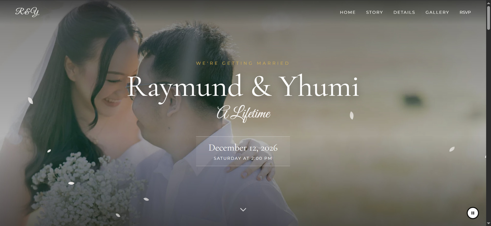

# Wedding Invitation Website

Personalized wedding invitation site for Raymund and Yhumi. Guests open a unique link, the page verifies the invite, then unlocks the full experience: story, ceremony details, gallery, countdown, background music, and RSVP.

The visual layout is based on [Ating Tagpuan](https://atingtagpuan.com/). I rebuilt the behavior around it: invite gating, guest personalization, RSVP, audio, countdown, and the rest of the client logic.



Replace `preview.jpg` to change the GitHub / social preview. Recommended size: 1280 × 640.

## What I built

- **Invite verification** — The site stays locked behind a curtain until `?invite=` matches a code in `data/invites.json`. Invalid or missing codes show an error and never open the page.
- **Personalized greeting** — A valid code renders the guest names on the curtain. Some family codes also show a seating-limit note.
- **RSVP modal** — Confirm Attendance / RSVP opens a modal and lazy-loads an embedded Google Form so responses land in a spreadsheet without a custom backend.
- **Live countdown** — Days, hours, minutes, and seconds until December 12, 2026, 2:00 PM.
- **Background music** — Plays after the curtain opens, with a floating play/pause control. Music pauses when the tab is hidden or the window loses focus, and resumes when the guest comes back.
- **Responsive UI** — Desktop nav plus a slide-in mobile menu, sticky navbar after scroll, and a masonry gallery.
- **Performance** — Hero and splash images are preloaded. Photos ship as WebP with JPEG fallbacks. RSVP iframe is created only when the modal opens.
- **Motion and accessibility** — Petal animation is skipped when `prefers-reduced-motion` is set. The main page is `inert` until the invite is granted so it cannot be tabbed into while locked.
- **Client-side view-source deterrent** — Right-click, drag-to-save on images, F12, Ctrl/Cmd+U (view source), Ctrl/Cmd+S (save page), and common DevTools shortcuts (Ctrl/Cmd+Shift+I/J/C) are blocked in the browser. This only runs on the client. The site is hosted on **free Cloudflare Pages**, which is static hosting, so there is no server of our own to add headers, middleware, or other server-side controls. Anyone who wants to can still fetch the HTML or open DevTools another way; this is meant to discourage casual guests, not to hide the code.

Frontend: HTML, CSS, and vanilla JavaScript. No framework, no build step. Hosted on Cloudflare Pages.

## How the invite flow works

1. Guest opens a link like `index.html?invite=code`.
2. `js/main.js` fetches `data/invites.json` (`cache: "no-store"`).
3. The code is matched case-insensitively. Names may be a string or an array (households).
4. On success, the curtain can be tapped open; on failure, the site stays locked.

RSVP submissions go to Google Forms. Venue maps use Google Maps links.

## Project structure

```
index.html          # Page markup and Open Graph tags
css/styles.css      # Layout, curtain, modal, responsive styles
js/main.js          # Invite gate, RSVP, countdown, audio, UI
data/invites.json   # Invite codes → guest names
images/             # Photos (WebP + JPEG)
preview.jpg         # Repo / social preview image
```

## Run locally

Because invite data is loaded with `fetch`, open the folder through a local server rather than as a `file://` page:

```bash
npx serve .
```

Then visit `http://localhost:3000/?invite=xxx` (demo code in `invites.json`).
